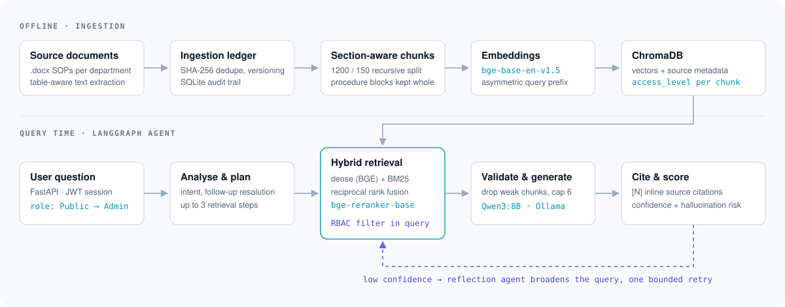

# Agentic AI Institutional Knowledge System

A local, citation-backed assistant that answers questions from a college's standard operating procedures (SOPs), and shows each user only what their role allows.

Staff and students ask things like *"What is the re-evaluation deadline?"* or *"Who approves a research grant?"* The answers are buried across dozens of departmental `.docx` SOPs. This system retrieves the relevant passages with hybrid search, generates an answer with a local LLM, cites every source, flags low-confidence answers, and declines when no relevant evidence is found.

- **Local inference.** Qwen3:8B runs on Ollama, so documents never leave the machine.
- **Hybrid retrieval.** Dense BGE embeddings and BM25 are fused with Reciprocal Rank Fusion, then reranked by a cross-encoder.
- **Role-based access in the retrieval query.** Restricted chunks are filtered out before they can reach the prompt.
- **Agentic control flow.** A LangGraph agent plans, validates context, scores confidence and retries once through a reflection step.
- **Tests.** 13 test modules with about 550 test functions.

> Built during my internship at SP-TBI (Jun–Jul 2026). A research manuscript on the system design and retrieval evaluation is in preparation.

---

## Architecture

<picture>
  <source media="(prefers-color-scheme: dark)" srcset="docs/architecture-dark.svg" />
  <source media="(prefers-color-scheme: light)" srcset="docs/architecture-light.svg" />
  
</picture>

### Offline: ingestion and indexing

| Stage | Module | What happens |
|---|---|---|
| Extraction | `ingestion_pipeline.py` | Reads `.docx` files from `data/staging/`. SOP tables are serialized into labelled text (Objectives, Inputs, Process description …) so their structure survives chunking. Unicode artifacts are cleaned. |
| Ledger | `ledger.py` | Each file is hashed (SHA-256). Unchanged files are skipped and duplicates rejected. A newer version of the same department module marks the old one `superseded`. All actions are logged to SQLite. |
| Metadata | `ingestion_pipeline.py` | Department comes from a `Module: X` header or the filename. Access level comes from first-page markers ("admin only", "faculty only", "for students only") and defaults to **Public**. |
| Chunking | `chunker.py` | `RecursiveCharacterTextSplitter` at 1,200 chars with 150 overlap. SOP sub-process blocks are kept whole up to 1,500 chars, section headings are copied onto every chunk, and chunk IDs are deterministic. |
| Embedding | `embeddings/` | `BAAI/bge-base-en-v1.5` (768-dim) with the BGE asymmetric query prefix. The model is loaded once as a singleton. |
| Index | `vector_store/` | ChromaDB stores each chunk with its vector and flat metadata (`department`, `access_level`, source, version …). |

### Query time: the agent

`agents/multi_agent_graph.py` compiles a LangGraph state machine:

```
query_analyzer ─(greeting / out of scope)─► final_response
      │
   planner ──► retrieval_agent ──► context_validator ──► response_generator
                    ▲                                          │
                    │                                  citation_formatter
             reflection_agent ◄──(low confidence)── confidence_evaluator ──► final_response
```

| Node | Responsibility |
|---|---|
| Query analyzer | Detects intent, resolves follow-ups from conversation memory, extracts metadata filters, short-circuits greetings |
| Planner | Splits a complex question into at most 3 retrieval steps |
| Retrieval agent | Hybrid retrieval per step (below), with the user's role applied |
| Context validator | Drops chunks with relevance below 0.15 and caps the context at 6 chunks |
| Response generator | Builds the prompt and calls Qwen3:8B on Ollama |
| Citation formatter | Groups chunks by document, flags superseded versions, rewrites `[SOURCE N]` to inline `[N]` |
| Confidence evaluator | Scores confidence from retrieval signals and flags hallucination risk |
| Reflection agent | If confidence is below 0.40, broadens the query and retries once. Low-confidence answers that remain are flagged with their hallucination risk |

If no chunk survives validation, the generator returns a fixed fallback answer instead of calling the LLM.

Every threshold lives in one frozen dataclass, `agents/agent_state.py → AgentConfig`, which both the graph and the tests import.

### Retrieval

```
query ─► BGE dense search (ChromaDB, role filter) ─┐
                                                    ├─► RRF (k = 60) ─► bge-reranker-base ─► top-k
query ─► BM25 keyword search (role filter) ─────────┘
```

- **Why hybrid?** SOP questions mix paraphrase ("how do I get my marks rechecked") with exact terms (form names, committee names). Dense search handles the first and BM25 the second.
- **Why fuse by rank?** Cosine similarity and BM25 scores live on different scales. RRF uses only ranks, so there are no fusion weights to tune (`retrieval/fusion.py`).
- **Why rerank?** A cross-encoder reads the query and passage together, which is more precise than comparing two independent embeddings. It runs only on the fused shortlist to keep latency down.

### Access control

| Role | Can retrieve |
|---|---|
| Public | Public |
| Student | Public, Student |
| Faculty | Public, Student, Faculty |
| Admin | Everything |

`retrieval/filters.py` turns the role into a ChromaDB `where` clause on `access_level`, so restricted chunks are excluded inside the vector query rather than filtered afterwards. An unrecognised role falls back to Public. Roles come from a JWT issued at login (`backend/auth.py`, bcrypt-hashed passwords). Unauthenticated endpoints always retrieve as Public.

---

## Getting started

### Prerequisites

- Python 3.11
- [Ollama](https://ollama.com) with the model pulled: `ollama pull qwen3:8b`
- About 6 GB free disk for the LLM, plus about 1.5 GB for the BGE embedding and reranker models (downloaded from Hugging Face on first use)
- Your own `.docx` documents. The institutional corpus used during development is **not** included.

### Run locally

```bash
python -m venv .venv
source .venv/bin/activate           # Windows: .venv\Scripts\activate
pip install -r requirements.txt

# 1. Put .docx files in data/staging/
mkdir -p data/staging

# 2. Ingest and chunk, then embed and index into ChromaDB
python ingestion_pipeline.py
python vector_store/index_pipeline.py

# 3. Create the demo users
python seed_users.py

# 4. Start the API and web UI (Ollama must be running)
export JWT_SECRET_KEY="$(python -c 'import secrets; print(secrets.token_urlsafe(48))')"
uvicorn backend.app:app --port 8000
```

Then open <http://localhost:8000>. Use it as a guest, or sign in with one of the local demo accounts from `seed_users.py` (`public_user`, `student_test`, `faculty_test`, `admin_test`) to see how answers change by role. The demo passwords are in that file. Don't reuse them anywhere real.

An alternative Streamlit client is in `frontend/ui.py`. It needs `pip install streamlit`, then `streamlit run frontend/ui.py`.

### API

| Method | Endpoint | Auth | Purpose |
|---|---|---|---|
| POST | `/api/auth/login` | — | Returns a JWT with the user's role |
| POST | `/api/chat` · GET `/api/chat/stream` | — | Guest chat (always Public), JSON or SSE |
| POST | `/api/chat/auth` · GET `/api/chat/auth/stream` | JWT | Role-aware chat with saved history |
| POST | `/api/agent/chat` | JWT | Full LangGraph agent with planning and reflection |
| GET/DELETE | `/api/history[/{session_id}]` | JWT | Conversation history |
| GET | `/api/documents/{doc_id}/view` | JWT | View a cited source, if your role permits |
| POST | `/api/upload` | Admin | Upload and incrementally index a new document |
| GET | `/api/admin/stats` · `/documents` · `/logs` · `/chroma` | Admin | Index and ingestion inspection |

---

## Evaluation

`scripts/evaluate_retrieval.py` compares three retrieval modes on a 20-query test set:

| Mode | Pipeline |
|---|---|
| `dense` | BGE + ChromaDB |
| `hybrid` | Dense + BM25 + RRF |
| `rerank` | Hybrid + `bge-reranker-base` |

It reports Precision@K, Recall@K, MRR, Hit@1, Hit@3, and mean and p95 latency.

```bash
python scripts/evaluate_retrieval.py --k 5
```

**Limitation:** there are no human relevance labels yet. A result counts as relevant if it comes from the query's target department. That penalises correct answers from other departments, so treat the numbers as directional. Building a small hand-labelled set is the next step for the manuscript.

## Tests

```bash
pytest -m "not slow"      # unit tests
pytest                    # also runs integration tests that load ChromaDB and the BGE models
```

The suite covers chunk validation, the ledger, embeddings, the Chroma store, hybrid retrieval and RRF, prompt building, citations, the RAG engine, the multi-agent graph and the document viewer's access checks.

## Repository layout

```
agents/         LangGraph graphs (linear agent + multi-agent with reflection) and AgentConfig
backend/        FastAPI app, JWT auth, SQLAlchemy models, document access service
embeddings/     BGE embedder and embedding pipeline
retrieval/      BM25, dense retriever, RRF fusion, cross-encoder reranker, RBAC filters
rag/            Prompt builder, Ollama client, citation engine, RAG engine
vector_store/   ChromaDB wrapper and indexing pipeline
frontend/       Web UI served by FastAPI (index.html, app.js) and a Streamlit client
scripts/        Retrieval evaluation
docker/         Dockerfile and Compose file (see limitations)
tests/          pytest suite
```

## Known limitations

- **Docker Compose is not yet working end to end.** `rag/ollama_client.py` always connects to `localhost:11434` and ignores the `OLLAMA_BASE_URL` that Compose sets, so the app container can't reach the Ollama container. The `sqlite_data:/app` volume also shadows the application code after the first build. Run locally until both are fixed.
- **Access levels are inferred from document text.** Unmarked documents default to Public. A production deployment would need explicit, reviewed access metadata.
- **`JWT_SECRET_KEY` has an insecure fallback** in `backend/auth.py`. Always set it.
- **Streamlit isn't in `requirements.txt`** (it's only needed for `frontend/ui.py`).
- **No corpus, screenshots or published benchmark numbers yet.** See Evaluation.

## Tech stack

Python · LangGraph · Sentence Transformers (BGE) · rank-bm25 · ChromaDB · Ollama (Qwen3:8B) · FastAPI · SQLAlchemy · SQLite · PyJWT · passlib/bcrypt · pytest

## Author

**Aditya Malekar**, Computer Engineering, Sardar Patel Institute of Technology, Mumbai.
[GitHub](https://github.com/adityam260206) · [LinkedIn](https://www.linkedin.com/in/aditya-malekar-798515386/)
